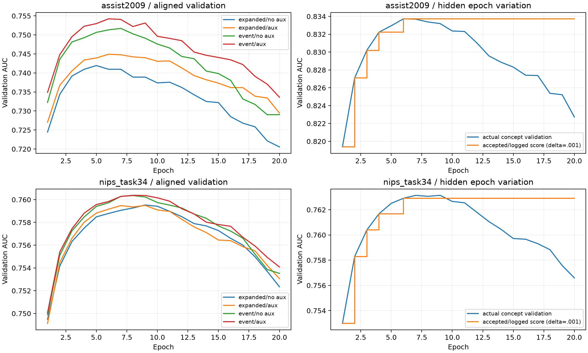

# 提升受限的归因诊断：主任务、选模与超参数

日期：2026-10-31。分支 `feat/student-state-simulator`。问题是为什么此前七方案及同数据集合并增益有限。本次补做两个数据集各6个、总计12个受控训练轨迹（fold0、seed42、固定20 epoch，保存全部检查点），并冻结后使用原官方测试链路确认。旧模型、旧结果和标准训练器均未覆盖。

核心判断：**不能笼统说辅助措施没生效，也不能把问题全推给超参。ASSIST存在很明确的主任务/评估条件错位，粗选模也掩盖了变化；NIPS这类错位较小，校正后辅助任务仍几乎没有额外收益，学习率只有小幅且尚不确定的额外收益。**

## 1. 原主任务有同题标签反馈，主指标却没有

一个原始题有多个知识点时，原训练把它展开为相邻位置。预测后一个副本时，输入已包含前一个副本的同一0/1响应。不是只有答对时反馈，错误标签0也相同。这是同题标签前馈，不是训练学生和测试学生混用。

| 数据集 | 训练计分位置中同题后续副本 | 验证计分位置中同题后续副本 | 原DKT验证：后续副本AUC | 首副本AUC | 原标准验证AUC |
|---|---:|---:|---:|---:|---:|
| ASSIST2009 | 16.23% | 18.24% | 0.999998617 | 0.742799343 | 0.830839499 |
| NIPS task34 | 1.20% | 1.22% | 0.999915672 | 0.757067415 | 0.762496754 |

而主指标使用的 `expand_question` 会删去当前目标题的其他concept副本，从题目前状态分别查询各目标concept，再做late fusion。原标准验证里接近1的副本预测不等于新题预测能力。DKT.forward中变量名q实际接收cseqs，模型仍然编码知识点；不是“不读知识点”导致这个问题。

新主loss保持DKT结构/输入不变：**每个完整原始题，从题目前同一状态预测其所有去重知识点概率，平均后只计算一次整题BCE。** 跨chunk的部分目标不算完整题，第一题没有前史则排除。旧历史中的已完成题仍正常输入。该修正同时改变了反馈副本计分、每题权重和聚合方式；当前不能把全部收益只归因于去掉副本之一，需后续细分三者贡献。

固定学习率0.001、无辅助任务，测试主指标中的整题主loss效应：

- ASSIST：+0.005090007，学生配对自举95%区间 [+0.002716487, +0.007351679]。
- NIPS：+0.000943266，学生配对自举95%区间 [+0.000517669, +0.001394604]。

同样参数量、同样优化器就能改善，ASSIST此前增益小不能据此解释为骨干已经达到能力上限。

## 2. 保存门槛比目标增益还粗，旧日志还隐藏了真实曲线

原训练器仅在 `auc > accepted_best + 0.001` 时保存并重置patience；`validauc`只在这时更新，打印的是保留检查点分数，不是本epoch实际auc。它可能在小幅改善时不保存，也可能在缓慢改善时触发早停。NIPS上次5轮联合的验证分数总跨度仅0.000641，小于单次保存门槛。因此旧日志不能作为“每epoch真实曲线”读取，也无法事后恢复未保存的峰值。

本次记录真实concept AUC及同口径验证窗口AUC。4条原目标重放轨迹（两个数据集的baseline/joint）在旧保留epoch的骨干参数与旧检查点**逐元素相同，最大差值0**，排除“换随机种子碰巧更好”的解释。

仅在同一原主任务轨迹上细选纯DKT检查点，测试相对旧baseline的变化：ASSIST +0.001270628，学生配对自举95%区间 [+0.000578016, +0.002000755]；NIPS +0.000753345，学生配对自举95%区间 [+0.000394315, +0.001103751]。两个baseline的精细concept选模与同口径窗口选模恰好分别都选第5/9 epoch，所以此处不能把变化算作辅助监督创造的信息。

更细门槛不等于一定选对主指标：concept AUC与逐题窗口的条件、加权和历史截断不同。之前7个冻结模型的标准验证与旧测试排名Spearman：ASSIST 0.6429；改用同口径验证为 0.9643。NIPS两者均约0.8571。7点相关只是描述，不能当总体统计证明。

下面比较原门槛、零门槛concept选模和同口径窗口选模；“同预算”只允许原规则模拟早停之前的epoch，不把多训练的epoch偷偷算入门槛收益。

### ASSIST检查点

| 轨迹 | 原规则epoch | 精细concept选模epoch | 同预算窗口选模epoch | 原规则对应窗口AUC | 同预算窗口选模AUC |
|---|---:|---:|---:|---:|---:|
| `expanded_base` | 4 | 5 | 5 | 0.740954505 | 0.741947810 |
| `expanded_joint` | 6 | 6 | 6 | 0.744920741 | 0.744920741 |
| `event_base` | 3 | 3 | 7 | 0.748144817 | 0.751713487 |
| `event_joint` | 4 | 6 | 6 | 0.752277074 | 0.754234070 |
| `event_joint_lr_low` | 6 | 6 | 11 | 0.752224252 | 0.753447537 |
| `event_joint_lr_high` | 3 | 4 | 6 | 0.750965993 | 0.752353620 |

### NIPS检查点

| 轨迹 | 原规则epoch | 精细concept选模epoch | 同预算窗口选模epoch | 原规则对应窗口AUC | 同预算窗口选模AUC |
|---|---:|---:|---:|---:|---:|
| `expanded_base` | 6 | 9 | 9 | 0.758785251 | 0.759529539 |
| `expanded_joint` | 6 | 9 | 9 | 0.759160315 | 0.759489893 |
| `event_base` | 6 | 8 | 8 | 0.759723864 | 0.760358939 |
| `event_joint` | 6 | 9 | 8 | 0.759835662 | 0.760379542 |
| `event_joint_lr_low` | 11 | 12 | 12 | 0.760937884 | 0.760977912 |
| `event_joint_lr_high` | 4 | 5 | 5 | 0.758906969 | 0.759146620 |

[曲线PDF](assets/dkt_diagnostic_20261031_curves.pdf)。右图为新实验实际观测曲线及模拟原accepted-best阶梯，不是从旧打印日志“还原”的曲线。

## 3. 辅助任务是否完全没用：两边结论不同

在修正主任务、同学习率0.001、相同骨干和相同选模协议下，联合辅助相对无辅助的测试效应：

- ASSIST：+0.002957771，学生配对自举95%区间 [+0.001398272, +0.004521680]。
- NIPS：+0.000084252，学生配对自举95%区间 [-0.000274999, +0.000468867]。

原展开主任务中的辅助效应也保留：ASSIST +0.002601173，学生配对自举95%区间 [+0.001497346, +0.003681510]；NIPS +0.000093570，学生配对自举95%区间 [-0.000329076, +0.000515450]。不能仅用“比此前粗选的baseline高”证明辅助信号有独立收益。

已有信号并非全是独立新标注：ASSIST独立成功代理只有474/229467条不同于原正误，主要新增的是监督时点/模板关系；画像复用已有正误聚合；选项正确身份与正误有确定关系，真正新增的是错误身份；信心只有约四分之一原始记录可用。旧错误选项相对binary control、真实父主题相对随机分组的额外收益区间都含0。它们可改善辅助任务拟合或起正则作用，但不保证增加主任务可泛化信息。

此外，已有丰富历史教师在训练时使用 `teacher_event_mask`，即只在原始事件首副本上监督；教师蒸馏的收益可能部分来自更接近目标的任务口径。此前thin teacher也取得大部分收益，rich对thin的额外差值区间含0。当前没有重新训练“相同主目标的rich/thin教师”来分离这一因素，因此不把旧蒸馏全部收益归给丰富历史。

## 4. 超参问题有多大

本次只对整题＋联合辅助做固定的学习率0.0005/0.001/0.002探测，未把它包装成充分超参搜索，也未同步给所有baseline做学习率网格。其他参数固定：embedding200、dropout0.2、batch32、Adam，20epoch。

### ASSIST全部6条验证控制

| 控制组 | 学习率 | 最佳同口径验证窗口AUC | epoch | 原门槛选定epoch |
|---|---:|---:|---:|---:|
| 原展开主loss／无辅助 | 0.001 | 0.741947810 | 5 | 4 |
| 原展开主loss／联合辅助 | 0.001 | 0.744920741 | 6 | 6 |
| 整题主loss／无辅助 | 0.001 | 0.751713487 | 7 | 3 |
| 整题主loss／联合辅助 | 0.001 | 0.754234070 | 6 | 4 |
| 整题＋辅助／LR0.0005 | 0.0005 | 0.753447537 | 11 | 6 |
| 整题＋辅助／LR0.002 | 0.002 | 0.752353620 | 6 | 3 |

### NIPS全部6条验证控制

| 控制组 | 学习率 | 最佳同口径验证窗口AUC | epoch | 原门槛选定epoch |
|---|---:|---:|---:|---:|
| 原展开主loss／无辅助 | 0.001 | 0.759529539 | 9 | 6 |
| 原展开主loss／联合辅助 | 0.001 | 0.759489893 | 9 | 6 |
| 整题主loss／无辅助 | 0.001 | 0.760358939 | 8 | 6 |
| 整题主loss／联合辅助 | 0.001 | 0.760379542 | 8 | 6 |
| 整题＋辅助／LR0.0005 | 0.0005 | 0.760977912 | 12 | 11 |
| 整题＋辅助／LR0.002 | 0.002 | 0.759146620 | 5 | 4 |

ASSIST的默认0.001在验证集优于减半和加倍，不能把主要问题解释为学习率恰好没调对。NIPS较小学习率的测试点估计多0.000344711，但95%区间[-0.000088466,+0.000752012]包含0；优化设置可能有帮助，尚未证实其单独收益稳定。没有搜索dropout/hidden size/权重全网格，不能断言所有超参都已经最优。

真实曲线显示这些轨迹窗口验证峰值多出现在前20epoch内，后期训练loss仍降而验证转差；不是简单把epoch从20加到100就必然更好。该结论仅针对当前模型与这几组学习率。

## 5. 梯度冲突：量化，不作万能解释

| 数据集 / 检查点 | 辅助合成梯度与主梯度平均cos | 负方向batch比例 | 辅助/主梯度范数比 |
|---|---:|---:|---:|
| assist2009 / old_full | 0.3064 | 0.00% | 0.5707 |
| assist2009 / old_selected | 0.1326 | 15.62% | 0.3100 |
| assist2009 / event_joint | 0.1249 | 15.62% | 0.2954 |
| nips_task34 / old_full | 0.2200 | 15.62% | 0.4797 |
| nips_task34 / old_selected | 0.3867 | 6.25% | 0.1580 |
| nips_task34 / event_joint | 0.3148 | 3.12% | 0.1395 |

旧完整组合的合成辅助梯度cos均值为ASSIST约0.306、NIPS约0.220，负方向比例分别0%和15.625%；没有证据显示大多数batch的辅助合成梯度持续与主任务反向。因此目前不把“整体梯度冲突”列为主因。

32个均匀抽取训练batch，在固定训练检查点、eval模式关闭dropout、原生LSTM反向中测量。负方向比例说明局部方向不一致，不能直接证明整个训练过程存在持续负迁移，也不能据此把全部损失归因于冲突；各模型训练状态/主目标不同，不能把表中变化都因果归给权重。完整分项见原始JSON。真正判断辅助收益仍以上面匹配控制及测试区间为准。

## 6. 冻结后的官方主指标确认

所有病例的epoch、学习率和扩展控制名单在读取新测试前由验证固定。四条matched factorial都用学习率0.001；另加验证最好的LR病例（若不同）。所有新测试仍运行原 `evaluate_question/late_fusion`，ASSIST batch128、NIPS512，主指标直接读取 `all_results.json` 的 `windowauclate_mean`。同状态已测试的旧joint复用结果，明确标记，不重复挑选。

### ASSIST测试

| 冻结确认组 | 选择epoch | windowauclate_mean（测试） | 说明 |
|---|---:|---:|---|
| 原展开主loss／无辅助 | 5 | 0.752100834 | 原官方测试链路 |
| 原展开主loss／联合辅助 | 6 | 0.754702007 | 旧检查点状态逐元素相同，复用旧测试 |
| 整题主loss／无辅助 | 7 | 0.757190842 | 原官方测试链路 |
| 整题主loss／联合辅助 | 6 | 0.760148612 | 原官方测试链路 |

### NIPS测试

| 冻结确认组 | 选择epoch | windowauclate_mean（测试） | 说明 |
|---|---:|---:|---|
| 原展开主loss／无辅助 | 9 | 0.768196158 | 原官方测试链路 |
| 原展开主loss／联合辅助 | 9 | 0.768289728 | 原官方测试链路 |
| 整题主loss／无辅助 | 8 | 0.769139424 | 原官方测试链路 |
| 整题主loss／联合辅助 | 8 | 0.769223676 | 原官方测试链路 |
| 整题＋辅助／LR0.0005 | 12 | 0.769568387 | 原官方测试链路 |

整题＋调参联合版相对此前最强单方案：ASSIST +0.005935526，学生配对自举95%区间 [+0.004153192, +0.007748109]；NIPS +0.001345451，学生配对自举95%区间 [+0.000867837, +0.001814150]。该比较混合主任务、选模和LR，不等同于单独辅助贡献。

## 7. 边界、验证与证据

- 单fold0、单seed42；所有因果效应都限当前匹配控制。bootstrap1000次按学生配对（seed20261031），条件于固定训练模型/测试群体，不覆盖训练seed/fold方差。
- 加速器只用于验证，不重写官方测试。与原预处理/评估在固定验证子集比较，目标ID、历史、标签相同；批形状的float32数值及4位舍入导致少量概率差0.0001，验证AUC差约4e-6，在1e-5以内。小于此量级的验证差不解释为实质改善。
- 新主loss修正了多个相关因素；尚未单独拆分副本去反馈、每题计权和concept融合，尚未搜索其他结构/数据集，也未证明心理状态真值被恢复。
- **126项相关检查通过**，原训练器及七模型代码未改；修正为独立 `DiagnosticJoint` loss/runner。固定CUDA批预取仅减少原wrapper/Python开销，四条重放轨迹参数逐元素相同，顺序、目标和优化器不变。

证据：

- [全部控制与确认JSON](../logs/causal_diagnostics_20261031/results.json) / [控制CSV](../logs/causal_diagnostics_20261031/controls.csv)
- [预登记协议](../logs/causal_diagnostics_20261031/protocol.json) / [测试确认计划](../logs/causal_diagnostics_20261031/confirmation_plan.json)
- [副本比例与旧排名](../logs/causal_diagnostics_20261031/static_audit.json)
- [旧模型逐项验证审计](../logs/causal_diagnostics_20261031/existing_model_diagnostics.json)
- [重放参数一致性](../logs/causal_diagnostics_20261031/replay_parity_all.json)
- [加速验证与官方子集核验](../logs/causal_diagnostics_20261031/fast_window_verification.json)
- [32 batch梯度探针](../logs/causal_diagnostics_20261031/gradient_probe.json)
- [官方主指标配对自举](../logs/causal_diagnostics_20261031/primary_bootstrap.json)
- [确认前冻结选择](../logs/causal_diagnostics_20261031/selection_before_primary_test.json)
- [源码快照](../logs/causal_diagnostics_20261031/source_manifest.json)
- [相关测试](../logs/causal_diagnostics_20261031/all_tests.txt)
- [模型、20epoch轨迹和预测](../examples/saved_model/causal_diagnostics_20261031)

下一步优先级应是把无同题反馈的整题主目标与同口径验证做成可维护的独立训练入口，再用更多seed/fold验证；NIPS需要检验超出正误重编码/静态题目先验的监督。继续堆辅助头、或把不显著的小差值解释成学生模拟进步，都不足以解决当前问题。

2026-10-31 复盘补充：已使用固定官方pyKT提交的原始DKT与evaluate_question独立重算两个baseline和两个最终模型，逐题概率及AUC差均为0。完整52行性能表与训练/选模协议变更的单独披露见 [完整性能与统计口径复盘](DKT_完整性能与统计口径复盘.md)。测试统计保持原版，不代表训练loss和选模还完全遵循原默认实验协议。
